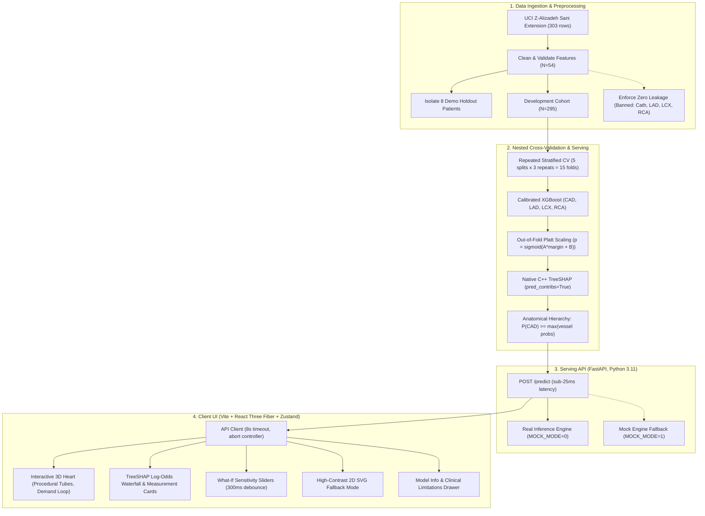

# CardioVision: Multimodal 3D Cardiovascular Risk Visualization & Prediction

[](https://github.com/Sohaam007/cardiovision/actions/workflows/ci.yml)
[](https://creativecommons.org/licenses/by/4.0/)
[](https://python.org)
[](https://react.dev)

CardioVision is an interactive clinical decision-support and visual risk stratification web platform developed for Track A of the Multimodal AI Hackathon 2026. The system ingests 54 multimodal patient features (demographics, vital signs, symptom history, 12-lead ECG, echocardiography, and laboratory biomarkers) to predict overall Coronary Artery Disease (CAD) risk alongside territory-specific stenosis in the Left Anterior Descending (LAD), Left Circumflex (LCX), and Right Coronary Artery (RCA). Live predictions are rendered directly onto an interactive 3D coronary anatomy model—procedurally shaded by predicted stenosis probability without ungrounded lesion location claims—complemented by sub-25ms native TreeSHAP explainability in calibrated log-odds space, evidence-based reference ranges, and interactive physiological sensitivity exploration.

---

## Live Deployments & Demo Links

- **Live Web Application (Vercel):** [https://cardiovision-sigma.vercel.app](https://cardiovision-sigma.vercel.app)
- **Production API Server (Render):** [https://cardiovision-vwkj.onrender.com](https://cardiovision-vwkj.onrender.com)
- **API Health Check:** [https://cardiovision-vwkj.onrender.com/health](https://cardiovision-vwkj.onrender.com/health)
- **Interactive API Documentation:** [https://cardiovision-vwkj.onrender.com/docs](https://cardiovision-vwkj.onrender.com/docs)
- **Video Walkthrough (YouTube):** [https://youtu.be/placeholder-cardiovision-demo](https://youtu.be/placeholder-cardiovision-demo) *(3-10 min walkthrough)*

---

## Mandatory Clinical Safety Disclaimer

> [!WARNING]
> **For decision support and educational purposes only. Not a medical device. Not a substitute for formal diagnostic imaging or clinical judgment.**
>
> This tool estimates the likelihood of coronary artery disease and vessel-level stenosis from a single-center research dataset (303 consecutive patients). Predictions can be wrong. The 3D colors show model-estimated probability for each whole vessel; they do not show where a blockage is. Do not use this tool for diagnosis or treatment decisions. Always rely on qualified clinicians and formal diagnostic imaging.

---

## System Architecture



---

## Key Performance Metrics (Repeated 5x3 Stratified CV, N=295)

All reported metrics come strictly from outer test folds in `models/metrics.json` and `docs/report_numbers.md`:

| Target Artery | ROC-AUC (Mean &plusmn; SD) | 95% Confidence Interval | PR-AUC | Accuracy | Sensitivity (Default) | Sensitivity (Screening Point) | Brier Score | ECE |
|---|---|---|---|---|---|---|---|---|
| **CAD (Overall)** | **0.9026 &plusmn; 0.0372** | [0.8838, 0.9215] | 0.9569 | 84.97% | 91.11% | 90.16% (threshold 0.56) | 0.1109 | 0.0940 |
| **LAD Artery** | **0.8376 &plusmn; 0.0436** | [0.8155, 0.8597] | 0.8745 | 78.53% | 86.34% | 90.20% (threshold 0.43) | 0.1621 | 0.1452 |
| **LCX Artery** | **0.7584 &plusmn; 0.0456** | [0.7353, 0.7814] | 0.6453 | 69.83% | 51.69% | 90.25% (threshold 0.27) | 0.1976 | 0.1102 |
| **RCA Artery** | **0.7011 &plusmn; 0.0477** | [0.6769, 0.7252] | 0.6099 | 67.57% | 37.33% | 90.72% (threshold 0.25) | 0.2082 | 0.1070 |

> [!NOTE]
> **Scientific Transparency on Distal Vessels:** While CAD (AUC 0.9026) and LAD (AUC 0.8376) exhibit strong discriminative power, LCX (0.7584) and RCA (0.7011) reflect well-documented clinical challenges in detecting circumflex and right coronary artery disease via standard non-invasive resting ECG and echocardiography. CardioVision reports these numbers honestly without data manipulation and provides dedicated screening operating thresholds (0.27 and 0.25) for rule-out triage.

---

## Quickstart & Local Development

### Prerequisites
- Python 3.11+
- Node.js 18+ and npm

### Makefile Commands
```bash
# 1. Complete Environment Setup (Python venv + Node packages)
make setup

# 2. Train Models, Platt Calibration & Export Artifacts
make train

# 3. Launch Backend API Server (FastAPI on http://localhost:8000)
make api

# 4. Launch Frontend Development Server (Vite on http://localhost:5173)
make web

# 5. Run Complete Test Suite (Pytest + Zero Leakage + Web E2E Tests)
make test
```

---

## Repository Structure

```
CardioVision/
├── api/                     # Lightweight FastAPI backend
│   ├── main.py              # Endpoints: /health, /schema, /demo, /predict
│   ├── inference.py         # Sub-25ms native TreeSHAP inference engine
│   └── demo_patients.json   # Precomputed offline predictions for 8 holdout patients
├── data/                    # Dataset storage
│   └── raw/                 # UCI Z-Alizadeh Sani Extension CSV (303 patients)
├── docs/                    # Architectural specs, reports, and evidence logs
│   ├── 00_CONTEXT.md        # Track A challenge brief & scoring rubrics
│   ├── 04_API_CONTRACT.md   # Frozen API schemas and contracts
│   ├── 07_DEPLOY.md         # Production deployment runbook (Render + Vercel)
│   ├── figures/             # Diagnostic curves, SHAP beeswarm, and screenshots
│   ├── report_numbers.md    # Verified single source of truth for all quantitative claims
│   ├── report.md            # Hackathon technical report source
│   ├── Track_A_report.pdf   # Formatted 6-page technical report
│   └── STATUS.md            # Chronological task execution log
├── ml/                      # Machine learning training pipeline
│   ├── features.py          # Data cleaning, target extraction, zero-leakage guards
│   └── train.py             # 15-fold nested CV, Platt scaling, TreeSHAP export
├── models/                  # Trained artifacts & metadata
│   ├── booster_*.json       # Serialized XGBoost booster models
│   ├── calibration.json     # Cross-fitted Platt scaling parameters
│   ├── metrics.json         # Master CV results and baseline comparisons
│   └── feature_schema.json  # 54-feature clinical definitions and reference ranges
├── tests/                   # Automated validation suites
│   ├── test_no_leakage.py   # 24 synthetic mutation tests for zero target leakage
│   ├── test_api_contract.py # API request/response shape and validation tests
│   └── test_api_parity.py   # Latency benchmarks and offline-online parity checks
├── web/                     # Frontend client application
│   ├── src/scene/           # Three.js / R3F procedural heart & coronary geometry
│   ├── src/components/      # UI: 3D canvas, ClinicalPanel, RiskExplainer, ModelInfoDrawer
│   ├── src/store/           # Zustand state management
│   └── src/test/            # 43 in-browser E2E and unit test specifications
├── Makefile                 # Deterministic build, train, serve, and test targets
├── render.yaml              # Render blueprint infrastructure configuration
└── requirements.txt         # Strictly pinned Python 3.11 production dependencies
```

---

## Dataset Citation & Asset Licenses

CardioVision strictly enforces ethical open-source licensing:

| Asset | Source URL | License | Attribution Statement | Usage in CardioVision |
|---|---|---|---|---|
| **Z-Alizadeh Sani Extension** | [UCI Repository ID 411](https://archive.ics.uci.edu/dataset/411/extention+of+z) | CC BY 4.0 | Alizadehsani, R., Roshanzamir, M., & Sani, Z. "Extension of Z-Alizadeh Sani Dataset". UCI ML Repository. | Cleaned 54 features across 303 consecutive patients; zero target leakage. |
| **Procedural Coronary Tubes** | Native Three.js geometry | MIT | CardioVision Project Contributors | Procedural Catmull-Rom spline tubes representing LM, LAD, LCX, RCA. No third-party mesh dependencies. |
| **Procedural Thorax Shell** | Native Three.js geometry | MIT | CardioVision Project Contributors | Low-poly translucent torso context. |
| **Okabe-Ito Color Palette** | Okabe & Ito (2002) | Public Domain | Universal colorblind accessibility standard | CVD palette stop mapping for clinical inclusivity. |

---

## Authors & Hackathon Team

- **Soham** - Machine Learning Engineering, Feature Pipelines, Platt Calibration, TreeSHAP, API Serving
- **Debdas** - Cloud Deployment (Render/Vercel), CI/CD, Documentation, Technical Report, Video Walkthrough
- **Soumyadeep** - 3D Anatomical Visualization, React Three Fiber Scene Architecture, Viewport Interactions
- **Adin** - Clinical Dashboard UI, RiskExplainer Recharts Attributions, Sensitivity Levers, Clinical Validation Form
