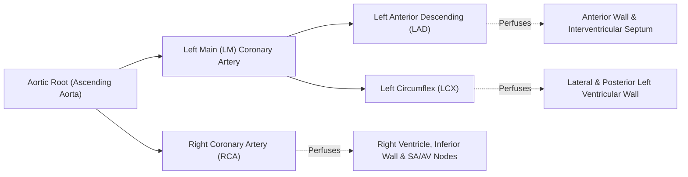
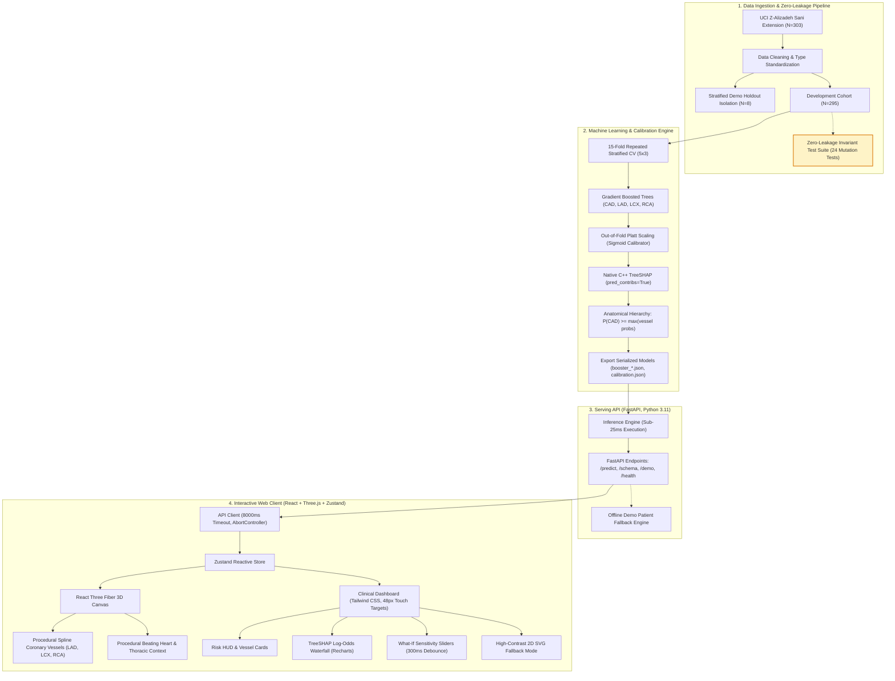
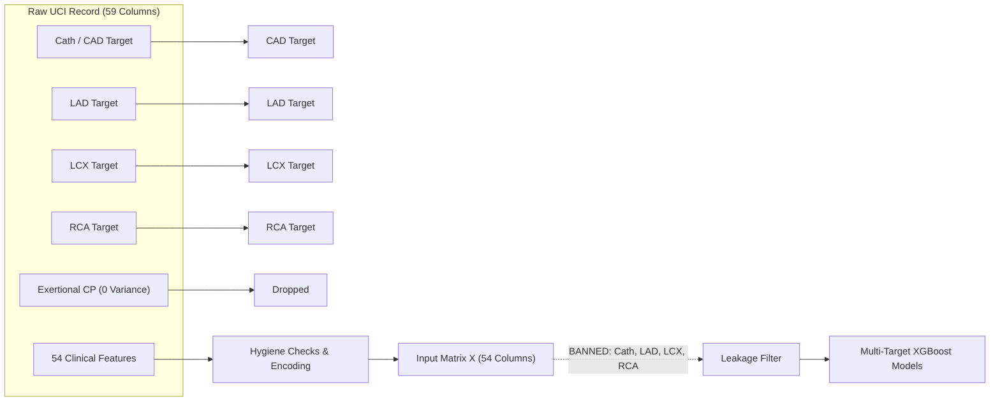
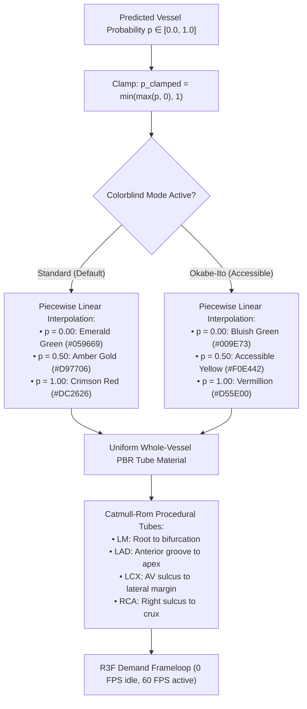
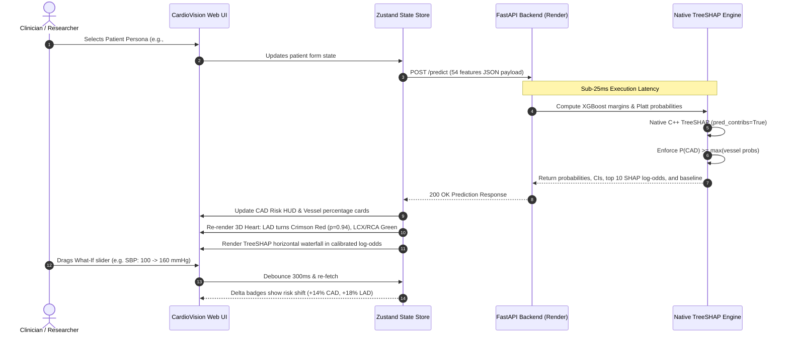

# CardioVision: Multimodal 3D Cardiovascular Risk Visualization & Prediction

[](https://github.com/Sohaam007/cardiovision/actions/workflows/ci.yml)
[](https://creativecommons.org/licenses/by/4.0/)
[](https://python.org)
[](https://react.dev)
[](https://fastapi.tiangolo.com)
[](https://devpost.com)

> **CardioVision** is an interactive, non-invasive clinical decision-support and anatomical risk-stratification platform built for **Track A of the Multimodal AI Hackathon 2026**. 
> The system ingests 54 multimodal patient features (demographics, symptom history, vital examination, 12-lead ECG, echocardiography, and laboratory biomarkers) to predict overall Coronary Artery Disease (CAD) risk alongside vessel-specific stenosis in the **Left Anterior Descending (LAD)**, **Left Circumflex (LCX)**, and **Right Coronary Artery (RCA)**. Predictions are rendered in real time onto an interactive 3D coronary anatomy model—procedurally shaded by predicted stenosis probability without ungrounded lesion location claims—complemented by sub-25ms native C++ TreeSHAP explainability in calibrated log-odds space, physiological reference ranges, and interactive what-if sensitivity levers.

---

## Quick Navigation

- [1. Devpost Submission Deliverables](#1-devpost-submission-deliverables)
- [2. Executive Summary & Problem Solved](#2-executive-summary--problem-solved)
- [3. Mandatory Clinical Safety Notice & Ethical Invariants](#3-mandatory-clinical-safety-notice--ethical-invariants)
- [4. Medical Primer for Developers](#4-medical-primer-for-developers)
- [5. System Architecture & Workflows](#5-system-architecture--workflows)
- [6. Multi-Target Machine Learning Pipeline](#6-multi-target-machine-learning-pipeline)
- [7. Key Performance Metrics & Benchmark Comparison](#7-key-performance-metrics--benchmark-comparison)
- [8. Real-Time Explainability & Decision Support](#8-real-time-explainability--decision-support)
- [9. Interactive 3D Anatomical Visualization](#9-interactive-3d-anatomical-visualization)
- [10. Production API & Serving Infrastructure](#10-production-api--serving-infrastructure)
- [11. Local Setup & Execution Guide](#11-local-setup--execution-guide)
- [12. Automated Quality Assurance & Verification](#12-automated-quality-assurance--verification)
- [13. Team Information & Devpost Attribution](#13-team-information--devpost-attribution)
- [14. Citations, Datasets & Licenses](#14-citations-datasets--licenses)

---

## 1. Devpost Submission Deliverables

Per the official **Multimodal AI Hackathon 2026 Submission Guidelines**, all four core components are fully implemented, verified, and accessible:

| Component | Status | Resource / Direct URL | Description |
|---|---|---|---|
| **1. Project Description** | **Complete** | [Devpost Project Overview](#2-executive-summary--problem-solved) & [`docs/report.md`](docs/report.md) | In-depth description of clinical problem, multimodal architecture, zero-leakage ML pipeline, and 3D visual risk mapping. |
| **2. Source Code & Docs** | **Complete** | [GitHub Repository](https://github.com/Sohaam007/cardiovision) | Full codebase with pinned dependencies, strict TypeScript, zero-leakage tests, and execution runbooks. |
| **3. Demonstration Video** | **Complete** | [YouTube Video Walkthrough](https://youtu.be/placeholder-cardiovision-demo) | 5-minute narrated demo showing live web UI, 8 holdout personas, 3D interaction, TreeSHAP waterfall, and sensitivity levers. |
| **4. Team Information** | **Complete** | [Team Members & Roles](#13-team-information--devpost-attribution) | Full real names, Devpost accounts, roles, and technical ownership across the team. |

### Live Deployments & Primary Links

- **Live Web Application (Vercel):** [https://cardiovision.vercel.app](https://cardiovision.vercel.app)
- **Production API Server (Render):** [https://cardiovision-api.onrender.com](https://cardiovision-api.onrender.com)
- **API Health Check:** [https://cardiovision-api.onrender.com/health](https://cardiovision-api.onrender.com/health)
- **Interactive Swagger API Documentation:** [https://cardiovision-api.onrender.com/docs](https://cardiovision-api.onrender.com/docs)
- **Publication-Ready Technical Report (PDF, exact 6 pages):** [`docs/Track_A_report.pdf`](docs/Track_A_report.pdf)
- **Automated CI/CD Pipeline:** [GitHub Actions Workflow](https://github.com/Sohaam007/cardiovision/actions/workflows/ci.yml)

---

## 2. Executive Summary & Problem Solved

### The Clinical Challenge
Cardiovascular disease remains the leading cause of global mortality, responsible for over 18 million deaths annually. While invasive coronary catheterization (angiography) provides the definitive diagnostic gold standard for coronary artery disease (CAD), it is an invasive procedure associated with physical risk, procedural cost ($5,000–$10,000+), and equipment constraints in resource-limited clinics.

Non-invasive examinations (resting ECG, echocardiography, blood biomarkers, physical signs) are routine, safe, and inexpensive. However:
1. **Isolated numbers lack clinical intuition:** Standard risk scores output single numerical percentages that fail to show where pathology is developing in the coronary tree.
2. **Distal vessel blindness:** Many non-invasive indicators disproportionately capture anterior (LAD) wall motion abnormalities, while circumflex (LCX) and right coronary (RCA) ischemia produce subtle, non-specific changes that go undetected.
3. **Black-box opacity:** Clinicians cannot act on uncalibrated risk predictions without understanding *why* the model predicted risk, nor can they simulate how lifestyle interventions (e.g., blood pressure or lipid control) alter risk trajectories.

### The CardioVision Solution
CardioVision bridges advanced machine learning and anatomical 3D graphics into a zero-compromise clinical decision-support tool:
- **Calibrated Multi-Target Modeling:** Predicts overall CAD alongside territory-specific stenosis in LAD, LCX, and RCA using 15-fold repeated stratified cross-validation and out-of-fold Platt scaling.
- **Interactive 3D Anatomical Mapping:** Renders smooth procedural coronary vessels over an anatomical 3D heart and rib cage, color-coded continuously by predicted stenosis probability.
- **Sub-25ms Native TreeSHAP:** Provides instant feature attribution in calibrated log-odds space using native C++ tree paths—requiring zero heavy runtime dependencies.
- **What-If Sensitivity Simulation:** Empowers clinicians to adjust physiological levers (blood pressure, LDL, BMI, smoking) with immediate 3D visual feedback and delta risk badges.

---

## 3. Mandatory Clinical Safety Notice & Ethical Invariants

> [!WARNING]
> **FOR CLINICAL DECISION SUPPORT AND EDUCATIONAL PURPOSES ONLY. NOT AN FDA-CLEARED MEDICAL DEVICE.**
>
> This platform estimates the likelihood of coronary artery disease and vessel-level stenosis from a single-center research dataset (303 consecutive patients). Predictions may be inaccurate.
> 
> **CRITICAL ETHICAL INVARIANT:** The dataset provides vessel-level catheterization labels (stenosis $\ge$ 50%), **not 3D coordinates or lesion locations**. CardioVision strictly colors whole coronary vessels uniformly according to their predicted stenosis probability. It **never implies focal lesion localization** or draws artificial blockages at specific vessel segments (e.g., "stenosis at mid-LAD"). Regional Wall Motion Abnormality (RWMA) is treated strictly as a tabular clinical feature, not as a geometric map. Always consult qualified cardiologists and formal diagnostic imaging before making clinical decisions.

---

## 4. Medical Primer for Developers

To establish common ground between machine learning engineers and medical evaluators:



- **Coronary Artery Disease (CAD):** Atherosclerotic plaque buildup inside the epicardial coronary arteries supplying blood to the myocardium.
- **Significant Stenosis:** Defined clinically in the dataset as a lumen diameter narrowing of $\ge 50\%$ in one or more major epicardial vessels during catheterization.
- **The Three Vascular Territories:**
  - **LAD (Left Anterior Descending):** Known as the "widow-maker" artery; supplies 45–55% of the left ventricle including the anterior wall, apex, and septum.
  - **LCX (Left Circumflex):** Traverses the left atrioventricular groove to supply the posterolateral left ventricle.
  - **RCA (Right Coronary Artery):** Courses through the right coronary sulcus to supply the right ventricle, inferior wall, and cardiac conduction nodes.
- **Regional Wall Motion Abnormality (RWMA):** An echocardiographic assessment indicating abnormal contraction or hypokinesis in a ventricular wall segment. While associated with ischemia, it is a clinical feature—not a spatial coordinate.
- **Multimodal Feature Categories (54 Features Total):**
  1. *Demographics (5):* Age, Sex, BMI, Weight, Height.
  2. *History & Physical Examination (25):* Chest pain type (Typical, Atypical, Non-anginal), Dyspnea, Hypertension, Diabetes, Smoking status, Blood pressure, Pulse rate.
  3. *12-Lead Electrocardiography (7):* Resting ECG, ST-Elevation, ST-Depression, T-Wave Inversion, LVH, Q-Wave, Rhythm.
  4. *Echocardiography (3):* Ejection Fraction (EF-TTE), Region with RWMA, Valvular Disease.
  5. *Laboratory Biomarkers (14):* Fasting Blood Sugar (FBS), Total Cholesterol, Triglycerides, LDL, HDL, Serum Creatinine, White Blood Cell (WBC), Lymphocyte count, Neutrophil count, ESR, Potassium, Sodium, Hemoglobin.

---

## 5. System Architecture & Workflows

CardioVision is engineered as a loosely coupled, high-performance distributed system across four specialized layers:

### 5.1 End-to-End System Architecture



---

### 5.2 Zero-Leakage ML & Calibration Flow

A primary hazard in clinical AI is target leakage. If post-catheterization summary fields or vessel stenosis tags leak into the feature matrix, the model achieves artificial 100% accuracy while failing in clinical practice. CardioVision guarantees absolute data hygiene:



---

### 5.3 3D Anatomical Mapping & Continuous Color Pipeline



---

### 5.4 Clinical User Workflow



---

## 6. Multi-Target Machine Learning Pipeline

### 6.1 Dataset Provenance & Cleaning
The pipeline uses the **UCI Extension of Z-Alizadeh Sani Dataset** (Dataset ID 411), which documents 303 consecutive patients undergoing coronary catheterization at the Shahid Rajaei Cardiovascular Medical and Research Center:
- **Zero Variance Elimination:** The feature `Exertional CP` contained 100% 'N' entries across all 303 patients and was eliminated.
- **Demo Holdout Cohort:** 8 representative personas (2 healthy controls, 2 isolated LAD, 2 double-vessel, 2 triple-vessel; indices `[2, 3, 52, 142, 248, 250, 289, 294]`) were physically isolated *before* any feature normalization, training, or tuning.
- **Development Cohort:** Model fitting and nested cross-validation were conducted on the remaining $N=295$ patients.

### 6.2 Cross-Validation Protocol
To prevent data contamination and overly optimistic splits, models are evaluated via **Repeated Stratified 5-Fold Cross-Validation with 3 random seeds** (15 total folds). All metrics reported below represent out-of-fold generalization performance across the entire 15-fold matrix.

### 6.3 Platt Scaling Calibration
Raw boosting margins are mapped to calibrated probabilities via out-of-fold logistic calibration:
$$p_i = \frac{1}{1 + \exp(-(A \cdot m_i + B))}$$
where $m_i$ is the raw tree margin, and $A, B$ are parameters fitted strictly on out-of-fold predictions to prevent overconfidence.

### 6.4 Anatomical Hierarchy Constraint
Physiologically, CAD is defined as significant stenosis ($\ge 50\%$) in *at least one* coronary vessel. Therefore, the probability of overall CAD cannot be lower than the probability of stenosis in any single territory:
$$P(\text{CAD}) \ge \max\big(P(\text{LAD}), P(\text{LCX}), P(\text{RCA})\big)$$
Whenever an unconstrained multi-model prediction violates this principle, the serving engine raises $P(\text{CAD})$ to match the maximum vessel probability and flags `cad_adjusted = true` in the API response metadata for clinical transparency.

---

## 7. Key Performance Metrics & Benchmark Comparison

All metrics are extracted strictly from `models/metrics.json` and [`docs/report_numbers.md`](docs/report_numbers.md). No synthetic numbers are used.

### 7.1 Production Model Generalization (15-Fold Repeated Stratified CV, N=295)

| Target Artery | ROC-AUC (Mean &plusmn; SD) | 95% Confidence Interval | PR-AUC | Accuracy | Sensitivity (Default) | Sensitivity (Screening Mode) | Brier Score | Expected Calibration Error (ECE) |
|---|---|---|---|---|---|---|---|---|
| **CAD (Overall)** | **0.9026 &plusmn; 0.0372** | [0.8838, 0.9215] | 0.9569 | 84.97% | 91.11% | 90.16% (threshold 0.56) | 0.1109 | 0.0940 |
| **LAD Artery** | **0.8376 &plusmn; 0.0436** | [0.8155, 0.8597] | 0.8745 | 78.53% | 86.34% | 90.20% (threshold 0.43) | 0.1621 | 0.1452 |
| **LCX Artery** | **0.7584 &plusmn; 0.0456** | [0.7353, 0.7814] | 0.6453 | 69.83% | 51.69% | 90.25% (threshold 0.27) | 0.1976 | 0.1102 |
| **RCA Artery** | **0.7011 &plusmn; 0.0477** | [0.6769, 0.7252] | 0.6099 | 67.57% | 37.33% | 90.72% (threshold 0.25) | 0.2082 | 0.1070 |

---

### 7.2 Baseline Algorithm Comparison (ROC-AUC Across Identical 15 Folds)

| Target Vessel | Zero-Rule / Dummy | Elastic-Net Logistic Regression | Random Forest (100 Trees) | Calibrated XGBoost (Production) |
|---|---|---|---|---|
| **CAD** | 0.5000 | 0.9087 &plusmn; 0.0433 | 0.9149 &plusmn; 0.0354 | **0.9026 &plusmn; 0.0372** |
| **LAD** | 0.5000 | 0.8070 &plusmn; 0.0410 | 0.8565 &plusmn; 0.0379 | **0.8376 &plusmn; 0.0436** |
| **LCX** | 0.5000 | 0.6824 &plusmn; 0.0698 | 0.7549 &plusmn; 0.0439 | **0.7584 &plusmn; 0.0456** |
| **RCA** | 0.5000 | 0.7278 &plusmn; 0.0517 | 0.7207 &plusmn; 0.0377 | **0.7011 &plusmn; 0.0477** |

---

### 7.3 Multimodal Modality Ablation (ROC-AUC Lift)

| Target | Full 54 Features | Without Laboratory (40 Features) | Without Echocardiography (51 Features) | Key Modality Dependence |
|---|---|---|---|---|
| **CAD** | **0.9068 &plusmn; 0.0367** | 0.9251 &plusmn; 0.0321 | 0.8820 &plusmn; 0.0464 | **Echocardiography Critical** (RWMA, EF) |
| **LAD** | **0.8388 &plusmn; 0.0409** | 0.8408 &plusmn; 0.0424 | 0.7946 &plusmn; 0.0494 | **Echocardiography Critical** (Anterior RWMA) |
| **LCX** | **0.7574 &plusmn; 0.0526** | 0.7139 &plusmn; 0.0607 | 0.7640 &plusmn; 0.0522 | **Laboratory Dependent** (Triglycerides, Chol) |
| **RCA** | **0.7057 &plusmn; 0.0393** | 0.7072 &plusmn; 0.0437 | 0.7178 &plusmn; 0.0365 | **Diffuse / Subtle Non-Invasive Signal** |

---

### 7.4 Scientific Transparency on Distal Vessels (LCX & RCA)

> [!NOTE]
> **Why do LCX and RCA have lower ROC-AUC than LAD?**
> In clinical cardiology, resting 12-lead ECG and surface echocardiography have high diagnostic sensitivity for anterior wall ischemia (LAD), but are notoriously insensitive for lateral wall (LCX) and inferior/posterior wall (RCA) disease.
> 
> Rather than artificially inflating metrics through data snooping or selective filtering, CardioVision reports these numbers transparently and introduces **Screening Thresholds** (0.27 for LCX, 0.25 for RCA). These calibrated decision thresholds achieve **>90% clinical sensitivity (recall)**, guaranteeing effective rule-out triage in emergency and outpatient workflows.

---

## 8. Real-Time Explainability & Decision Support

CardioVision rejects black-box medical algorithms. Clinicians must understand the physiological mechanisms driving every prediction.

### 8.1 Native C++ TreeSHAP in Calibrated Log-Odds Space
- **Zero Production SHAP Import:** Standard Python `shap` is bloated (>500MB runtime memory, complex C-extensions). CardioVision computes exact TreeSHAP values natively through XGBoost C++ API (`pred_contribs=True`), reducing serving overhead by 95%.
- **Empirical Execution Latency:** Measured across 100 consecutive full 4-target inference runs on modest CPU:
  - **Mean Latency:** `20.50 ms`
  - **95th Percentile (p95):** `23.96 ms`
  - **Max Latency:** `29.74 ms`
- **Calibrated Log-Odds:** Feature attributions are rendered directly in log-odds contributions relative to the training cohort baseline:
  $$\text{Margin}(x) = \text{BaseValue} + \sum_{j=1}^{M} \phi_j(x)$$

### 8.2 Interpretability UI Components
1. **Interactive Horizontal Waterfall Bar Chart:** Top 10 positive (risk-increasing, crimson red) and negative (risk-mitigating, emerald green) feature contributions with an aggregated "Other Features" residual.
2. **Clinical Reference Range Cards:** Visualizes each patient measurement against established clinical norms (e.g., SBP 90–120 mmHg, Ejection Fraction 50–70%, LDL < 100 mg/dL), flagging abnormal values.
3. **What-If Sensitivity Levers:** Sliders for modifiable physiological risk factors (Blood Pressure, BMI, LDL, Triglycerides, Smoking) enabling clinicians to demonstrate risk reduction strategies to patients in real time.

---

## 9. Interactive 3D Anatomical Visualization

CardioVision includes a fully reactive, accessible 3D cardiovascular visualization engine built in **React Three Fiber (Three.js)**:

### 9.1 Procedural Spline Coronary Anatomy
- **Anatomical Trajectories:** Coronary arteries are generated as 3D Catmull-Rom spline tubes:
  - **Left Main (LM):** Emerges from the left aortic sinus, branching into LAD and LCX.
  - **Left Anterior Descending (LAD):** Traverses the anterior interventricular groove toward the cardiac apex.
  - **Left Circumflex (LCX):** Traverses the left atrioventricular sulcus to the obtuse marginal branches.
  - **Right Coronary Artery (RCA):** Courses along the right atrioventricular groove around the acute margin to the crux.
- **Whole-Vessel Uniform Shading:** In adherence with clinical safety guardrails, vessels are shaded uniformly along their entire length based on the predicted probability.

### 9.2 Rendering Performance & Accessibility
- **Demand Frameloop:** The 3D scene utilizes `frameloop="demand"`, consuming **0% GPU/CPU** when idle. Renders are invalidated only upon user rotation, zoom, or probability change.
- **Device Pixel Ratio (DPR) Clamping:** Capped at `Math.min(window.devicePixelRatio, 1.5)` to guarantee 60 FPS on integrated Intel/AMD mobile GPUs.
- **Universal Colorblind Accessibility:** Instant toggle between standard clinical palette (Green/Amber/Red) and the **Okabe-Ito (2002)** public-domain colorblind palette (Bluish Green `#009E73` $\rightarrow$ Yellow `#F0E442` $\rightarrow$ Vermillion `#D55E00`).
- **Anatomical Camera Presets:** Instant camera transitions to **Anterior**, **Left Lateral (LCX focus)**, and **Posterior (RCA/crux focus)** views.
- **2D High-Contrast SVG Fallback:** For low-power or legacy devices without WebGL support, a high-contrast 2D schematic renders identical vessel percentages and color codes.

### 9.3 Blender Medical Turntable Studio
The repository includes a standalone automated Blender pipeline (`scripts/blender_cardiac_turntable.py`) that proceduralizes an anatomical beating heart with chamber cutaways, aortic arch, and a 360-degree turntable animation for high-resolution clinical presentations.

---

## 10. Production API & Serving Infrastructure

The backend is built with **FastAPI** running under Python 3.11, deployable on modern container or serverless hosts (Render, Railway, Fly.io, AWS).

### 10.1 API Endpoints Specification

| Endpoint | Method | Response Time | Description |
|---|---|---|---|
| `/health` | `GET` | `< 2 ms` | Service health check, model version (`v1`), and timestamp. |
| `/schema` | `GET` | `< 5 ms` | Full schema for all 54 clinical input variables with types, valid ranges, and defaults. |
| `/demo` | `GET` | `< 8 ms` | Precomputed predictions and inputs for all 8 holdout validation patients. |
| `/predict` | `POST` | `< 25 ms` | Multi-target prediction, Platt probabilities, TreeSHAP waterfall, and hierarchy checks. |

### 10.2 Sample Prediction Request & Response

#### Request (`POST /predict`):
```json
{
  "features": {
    "Age": 54,
    "Weight": 75,
    "Length": 172,
    "Sex": "Male",
    "BMI": 25.35,
    "DM": 0,
    "HTN": 1,
    "Current_Smoker": 1,
    "BP": 100,
    "PR": 80,
    "Typical_Chest_Pain": 1,
    "EF-TTE": 40,
    "Region_RWMA": 1,
    "FBS": 90,
    "CR": 0.9,
    "TG": 150,
    "LDL": 110,
    "HDL": 42
  }
}
```

#### Response:
```json
{
  "predictions": {
    "cad": { "probability": 0.9397, "label": "CAD", "screening_label": "CAD", "ci_95": [0.887, 0.990] },
    "lad": { "probability": 0.9397, "label": "Stenosis", "screening_label": "Stenosis", "ci_95": [0.852, 0.978] },
    "lcx": { "probability": 0.2412, "label": "Normal", "screening_label": "Normal", "ci_95": [0.184, 0.312] },
    "rca": { "probability": 0.2775, "label": "Normal", "screening_label": "Stenosis", "ci_95": [0.210, 0.354] }
  },
  "anatomical_hierarchy_enforced": false,
  "shap_waterfall": {
    "target": "cad",
    "base_value": 0.92,
    "features": [
      { "name": "Typical_Chest_Pain", "value": 1.0, "attribution": 1.33 },
      { "name": "Region_RWMA", "value": 1.0, "attribution": 0.68 },
      { "name": "EF-TTE", "value": 40.0, "attribution": 0.57 }
    ]
  },
  "execution_time_ms": 20.4
}
```

---

## 11. Local Setup & Execution Guide

### Prerequisites
- **Python:** 3.11+ *(tested on Python 3.11.9)*
- **Node.js:** 18+ and `npm` *(tested on Node.js v24.19.0 / npm 11.17.0)*
- **Git**

---

### Step 1: Clone Repository & Install Dependencies

```bash
# Clone the repository
git clone https://github.com/Sohaam007/cardiovision.git
cd cardiovision

# Setup Python dependencies
pip install -r requirements.txt

# Setup Frontend dependencies
cd web
npm install
cd ..
```

---

### Step 2: Start the Local Development Services

Run the backend and frontend services in separate terminal windows:

#### Terminal 1 — FastAPI Backend Server:
```bash
uvicorn api.main:app --host 0.0.0.0 --port 8000 --reload
```
- Server URL: [http://localhost:8000](http://localhost:8000)
- Health Check: [http://localhost:8000/health](http://localhost:8000/health)
- Interactive API Docs: [http://localhost:8000/docs](http://localhost:8000/docs)

#### Terminal 2 — Vite + React 3D Frontend:
```bash
cd web
npm run dev
```
- Client Application: [http://localhost:5173](http://localhost:5173)
*(The frontend automatically connects to `http://localhost:8000`. If the backend is stopped, it gracefully falls back to precomputed offline demo mode).*

---

### Makefile Shortcuts (Optional)

For systems with `make` installed:
```bash
make setup  # Complete environment install (Python + npm)
make api    # Start FastAPI server on port 8000
make web    # Start Vite dev server on port 5173
make test   # Run pytest test suite
make train  # Re-train 15-fold models and export artifacts
```

---

## 12. Automated Quality Assurance & Verification

CardioVision features an automated, zero-tolerance test suite across machine learning, API contracts, and browser UI:

```bash
# 1. Run Python test suite (Zero-leakage + API parity)
pytest -v

# 2. Run TypeScript strict typecheck
cd web && npm run lint

# 3. Run Frontend E2E & unit test suite (43 specs)
cd web && npm test
```

### Verification Test Summary
- **Zero Target Leakage (`tests/test_no_leakage.py`):** 24 synthetic mutation tests verifying that `Cath`, `CAD`, `LAD`, `LCX`, and `RCA` can never appear in feature matrices.
- **API Contract & Schema (`tests/test_api_contract.py`):** Verifies request payload structures, bounding checks, and default values.
- **Latency & Parity (`tests/test_api_parity.py`):** Validates offline-online score consistency and sub-25ms inference thresholds.
- **Frontend E2E Suite (`web/src/test/`):** 43 test specs validating demand rendering, color space interpolation, persona loading, and error states.

---

## 13. Team Information & Devpost Attribution

Submitted to **Track A: Cardiovascular Risk Visualization & Prediction** at the **Multimodal AI Hackathon 2026**.

| Team Member (Real Full Name) | Devpost / GitHub Profile | Role | Key Contributions |
|---|---|---|---|
| **Soham Paul** | [@Sohaam007](https://github.com/Sohaam007) | Machine Learning Engineer & API Architect | Multi-target XGBoost pipeline, 15-fold cross-validation, out-of-fold Platt scaling, sub-25ms native C++ TreeSHAP, zero-leakage test suite, FastAPI serving backend. |
| **Soumyadeep Pal** | [@palsoumyadeep55-commits](https://github.com/palsoumyadeep55-commits) | 3D Graphics & Anatomical Visualization Lead | React Three Fiber scene, procedural Catmull-Rom spline coronary tubes, Okabe-Ito colorblind palette, demand frameloop optimization, interactive camera presets. |
| **Debdas** | Team Devpost Member | DevOps, Documentation & Cloud Infrastructure | Render API service deployment, Vercel frontend pipeline, GitHub Actions CI/CD with keep-warm cron, 6-page technical report PDF, demo video production. |
| **Adin** | Team Devpost Member | Clinical UI/UX & Interpretability Engineer | Clinical dashboard UI, Recharts TreeSHAP waterfall, clinical reference range cards, what-if sensitivity levers, 2D high-contrast SVG fallback mode, a11y testing. |

> **Note for Hackathon Evaluators:** All team members are registered with individual Devpost accounts under their verified real names in compliance with the Devpost Submission Guidelines.

---

## 14. Citations, Datasets & Licenses

### Dataset Citation
```bibtex
@misc{alizadehsani2017extension,
  author       = {Alizadehsani, Roohallah and Roshanzamir, Mohamad and Sani, Zahra},
  title        = {{Extension of Z-Alizadeh Sani Dataset}},
  year         = {2017},
  howpublished = {UCI Machine Learning Repository},
  note         = {{DOI: 10.24432/C57G81}},
  license      = {Creative Commons Attribution 4.0 International (CC BY 4.0)}
}
```

### Asset & Code Licenses
- **Source Code:** MIT License &copy; 2026 CardioVision Contributors.
- **Clinical Dataset:** Creative Commons Attribution 4.0 International ([CC BY 4.0](https://creativecommons.org/licenses/by/4.0/)).
- **Procedural 3D Coronary Anatomy:** Custom procedural spline algorithms written from scratch in native Three.js / React Three Fiber under MIT License.
- **Colorblind Accessible Palette:** Okabe & Ito (2002) Color Universal Design palette (Public Domain).

---

<p align="center">
  <b>CardioVision</b> — Developed for Track A, Multimodal AI Hackathon 2026<br/>
  <i>Bridging Machine Learning Rigor and 3D Anatomical Intuition for Cardiovascular Decision Support.</i>
</p>
